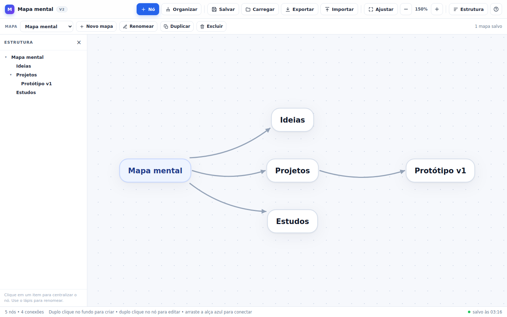

# superagent-sandbox

Repo sandbox para testes do dsh-superagent (nao usar para trabalho real)

## Editor de mapas mentais (v2)

Editor de mapas mentais em **arquivo único**: [`index.html`](index.html) reúne
HTML, CSS e JavaScript puro, sem CDN, sem npm e sem build step. Abre direto de
`file://`.



### Documentação

- **[Tutorial do usuário](docs/tutorial.md)** — do zero ao primeiro mapa, com
  capturas reais, atalhos e o que fazer quando o `localStorage` está bloqueado.
- **[Arquitetura](docs/arquitetura.md)** — modelo de dados, render, eventos,
  persistência, autolayout e **onde mexer para adicionar um recurso**.

### Novidades da v2

- **Autolayout:** o botão **Organizar** distribui os nós em árvore por nível,
  sem sobreposição, avisando antes de substituir posições manuais. `Ctrl/Cmd + Z`
  restaura o estado anterior.
- **Painel de estrutura:** árvore lateral com todos os nós; clicar centraliza,
  o lápis renomeia e a seta recolhe/expande ramos.
- **Múltiplos mapas nomeados:** criar, duplicar, renomear, excluir e trocar de
  mapa pelo seletor no topo. Tudo fica no `localStorage`; o mapa ativo e a
  câmera de cada um são preservados.
- **Otimização com medição:** o arraste passou a atualizar só o nó e as conexões
  incidentes, uma vez por frame; pan, zoom e o rascunho de conexão também são
  agrupados com `requestAnimationFrame` e não releem layout a cada evento. O
  histórico agora é compacto e limitado a 50 passos.
- **Migração automática da v1:** o mapa salvo em `mindmap-editor:v1` é lido na
  primeira abertura e a chave antiga é mantida como cópia de segurança.

### Como abrir

1. Baixe ou clone o repositório.
2. Dê um duplo clique em `index.html` — ou arraste o arquivo para uma aba do
   navegador.
3. Não é preciso servidor: o editor funciona direto de `file://`.

Funciona melhor em versões recentes de Chrome, Edge, Firefox e Safari.

Na primeira abertura o editor carrega um mapa de exemplo. Use **Novo mapa** para
começar do zero.

### Como usar (resumo)

- **Criar nó:** duplo clique no fundo; o botão **Nó** cria no centro ou um filho
  do nó selecionado.
- **Editar texto:** duplo clique no nó (ou `Enter`/`F2`). `Enter` confirma,
  `Shift+Enter` quebra linha e `Esc` cancela.
- **Mover nó:** arraste o nó; setas movem 8 px (`Shift` move 1 px).
- **Criar conexão:** arraste a alça azul `+` até outro nó, ou use `Shift` +
  arrastar o nó.
- **Selecionar e apagar:** clique no nó/conexão e pressione `Delete`/`Backspace`.
- **Organizar:** botão **Organizar**; confirme a substituição das posições.
- **Estrutura:** botão **Estrutura**; clique para centralizar, lápis para
  renomear, seta para recolher.
- **Mapas:** use o seletor e os botões **Novo mapa**, **Renomear**,
  **Duplicar** e **Excluir**.
- **Pan/zoom:** arraste o fundo; roda do mouse, botões `−`/`+` ou `Ctrl/Cmd + 0`
  para ajustar.
- **Salvar/carregar:** automático (com debounce de 500 ms); **Salvar** força a
  gravação, **Carregar** relê do navegador.
- **Exportar/importar:** **Exportar** baixa um JSON do mapa ativo; **Importar**
  substitui o mapa ativo após confirmação.
- **Ajuda:** o botão `?` lista os atalhos.

O passo a passo completo, com imagens, está no
[tutorial](docs/tutorial.md).

### Atalhos de teclado

| Atalho | Ação |
| --- | --- |
| `Tab` | Cria um nó filho conectado ao nó selecionado |
| `Enter` ou `F2` | Edita o nó selecionado |
| Setas | Move o nó selecionado 8 px (`Shift` move 1 px) |
| `Delete` / `Backspace` | Apaga o nó ou a conexão selecionada |
| `Ctrl/Cmd + Z` | Desfaz (até 50 passos) |
| `Ctrl/Cmd + Shift + Z` | Refaz |
| `Ctrl/Cmd + Y` | Refaz (alternativo) |
| `Ctrl/Cmd + S` | Salva neste navegador imediatamente |
| `Ctrl/Cmd + 0` | Ajusta a visualização ao conteúdo |
| `+` / `−` | Zoom |
| `0` | Volta ao zoom de 100% |
| `Esc` | Cancela a edição, limpa a seleção ou fecha a ajuda |

### Persistência e formato

O workspace completo fica em `localStorage` na chave `mindmap-editor:v2`:

```json
{
  "formatVersion": 2,
  "app": "editor-de-mapas-mentais",
  "activeId": "m-...",
  "maps": [
    {
      "id": "m-...",
      "name": "Mapa mental",
      "createdAt": "2026-11-04T03:16:00.000Z",
      "updatedAt": "2026-11-04T03:16:00.000Z",
      "viewport": { "x": 720, "y": 450, "scale": 1 },
      "nodes": [
        { "id": "n-raiz", "text": "Mapa mental", "x": 0, "y": 0 }
      ],
      "edges": [
        { "id": "e-1", "from": "n-raiz", "to": "n-ideias" }
      ]
    }
  ]
}
```

O JSON exportado representa **um mapa** e mantém o formato versionado da v1
(`formatVersion: 1`), com o campo opcional `name`:

```json
{
  "formatVersion": 1,
  "app": "editor-de-mapas-mentais",
  "name": "Planejamento 2026",
  "updatedAt": "2026-11-04T03:16:00.000Z",
  "viewport": { "x": 720, "y": 450, "scale": 1 },
  "nodes": [
    { "id": "n-raiz", "text": "Mapa mental", "x": 0, "y": 0 },
    { "id": "n-ideias", "text": "Ideias", "x": 260, "y": -96 }
  ],
  "edges": [
    { "id": "e-1", "from": "n-raiz", "to": "n-ideias" }
  ]
}
```

- `nodes[].x` / `nodes[].y` são o **centro** do nó, em unidades de mundo.
- `edges[]` são dirigidas (`from` → `to`), mas o editor não impõe hierarquia.
- `viewport` é opcional na importação; se estiver ausente, o mapa é enquadrado
  automaticamente.
- A importação substitui o conteúdo do mapa ativo; os múltiplos mapas ficam no
  navegador e não são exportados juntos.

### Desempenho medido

Medição em Chromium headless, mapa de **150 nós / 149 conexões**, arrastando o nó
raiz com 60 eventos `pointermove` no mesmo frame (`tests/measure.cjs`):

| Métrica | v1 (main, 68c3560) | v2 |
| --- | ---: | ---: |
| Mutações DOM durante o arraste | 9.061 | 14 |
| Leituras de layout (`getBoundingClientRect`) | 61 | 1 |
| Tempo do gesto (60 eventos + frame) | 484,9 ms | 20,1 ms |
| Reconstrução das arestas no arraste | todas as 149 a cada `pointermove` | só as incidentes (4 atualizações no total) |
| Escritas no `localStorage` durante o gesto | 0 | 0 |
| Escritas em 2 cliques em **Salvar** sem mudanças | 2 | 0 |
| Máximo do histórico (150 nós) | 100 entradas × 16,6 KB ≈ 1,66 MB | 50 entradas × 11,0 KB ≈ 0,55 MB |

A v1 já usava debounce na persistência (400 ms); a v2 mantém a ideia com 500 ms e
acrescenta a comparação de assinatura para não reescrever conteúdo idêntico. O
ganho principal está no arraste: a v1 recriava todas as conexões a cada
`pointermove`; a v2 atualiza só o nó e as conexões incidentes, uma vez por frame.

Números do ambiente de desenvolvimento; variam conforme máquina, navegador e
tamanho do mapa. O script de medição gera a tabela novamente.

### Limitações

- Os dados ficam apenas no navegador usado (cada navegador/arquivo tem seu próprio
  `localStorage`). Para backup ou para trocar de máquina, exporte o JSON.
- Alguns navegadores bloqueiam `localStorage` em `file://` ou em modo privado.
  Nesse caso o editor continua funcionando em memória e avisa que o salvamento
  local não está disponível — use **Exportar** / **Importar**.
- Sem colaboração em tempo real, sem IA embutida, sem imagens/embeds e sem gesto
  de pinça em telas de toque.
- O histórico de desfazer é por aba e por mapa; ele não é salvo no navegador.
- O painel de estrutura renomeia uma linha por vez; para várias linhas, edite o
  nó no mapa.
- O editor foi pensado para mapas pequenos e médios (algumas centenas de nós).
  Acima disso, a renderização em SVG pode ficar menos fluida.
- O autolayout trata o grafo como uma floresta a partir das raízes; conexões
  extras/ciclos continuam visíveis, mas não posicionam nós.

### Testes

O JavaScript inline pode ser validado sem abrir o navegador:

```bash
python3 - <<'PY'
import re
html = open('index.html', encoding='utf-8').read()
open('/tmp/editor-script.js', 'w', encoding='utf-8').write(re.search(r'<script>(.*?)</script>', html, re.S).group(1))
PY
node --check /tmp/editor-script.js
```

Os testes de navegador usam Playwright/Chromium **apenas como ferramenta de
desenvolvimento**; o editor continua sem dependências de runtime:

```bash
npm install --no-save playwright
npx playwright install chromium

node tests/smoke.cjs
node tests/measure.cjs --baseline /tmp/index-v1.html   # baseline opcional
node tests/capture.cjs --baseline /tmp/index-v1.html   # gera docs/img
```

- `tests/smoke.cjs`: cobre autolayout, painel de estrutura, múltiplos mapas,
  criar/editar/conectar, exportar/importar e `localStorage` bloqueado, sem erro
  de console.
- `tests/measure.cjs`: gera a tabela antes/depois acima.
- `tests/capture.cjs`: gera as capturas reais usadas no tutorial.

Para gerar o baseline da v1 a partir do histórico:

```bash
git show 68c3560:index.html > /tmp/index-v1.html
```

### Estrutura do repositório

```text
index.html                      editor completo (arquivo único)
docs/tutorial.md                tutorial do usuário, com capturas
docs/arquitetura.md             modelo, render, eventos, persistência e extensão
docs/pesquisa-mapas-mentais.md  pesquisa que embasou a v1
docs/img/                       capturas reais geradas com Playwright/Chromium
tests/smoke.cjs                 teste de fumaça em Chromium
tests/measure.cjs               medição antes/depois
tests/capture.cjs               geração das capturas
```

## Pesquisa

O levantamento que embasou as decisões está em
[`docs/pesquisa-mapas-mentais.md`](docs/pesquisa-mapas-mentais.md): comparação de
8 ferramentas, os 5 recursos que mais diferenciam as soluções atuais e a
arquitetura recomendada para um editor web sem build step.
