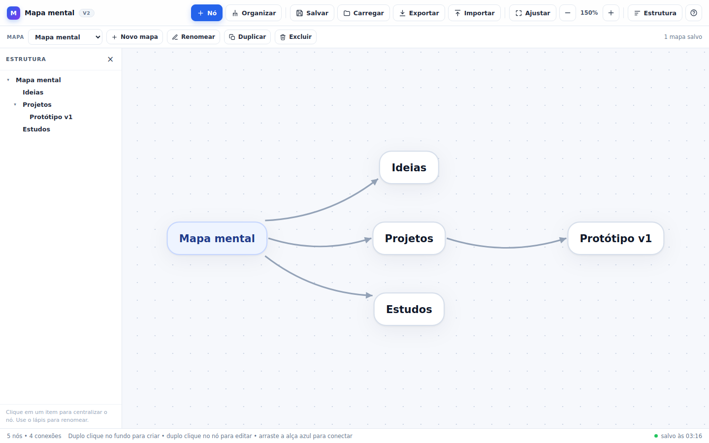
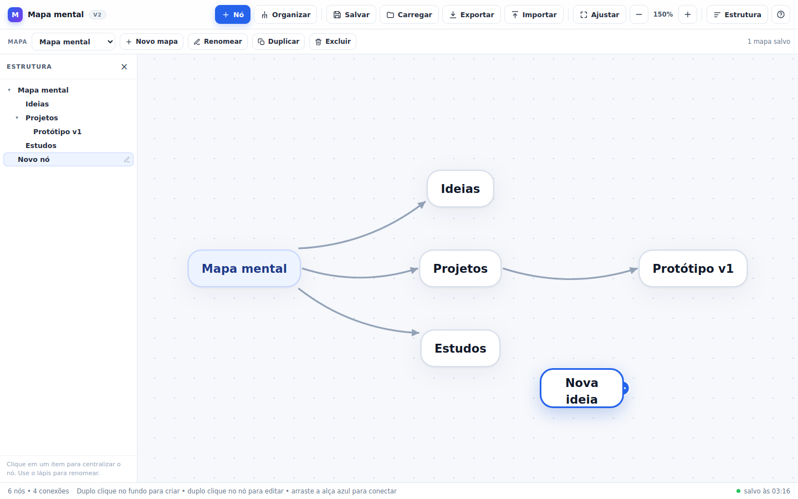
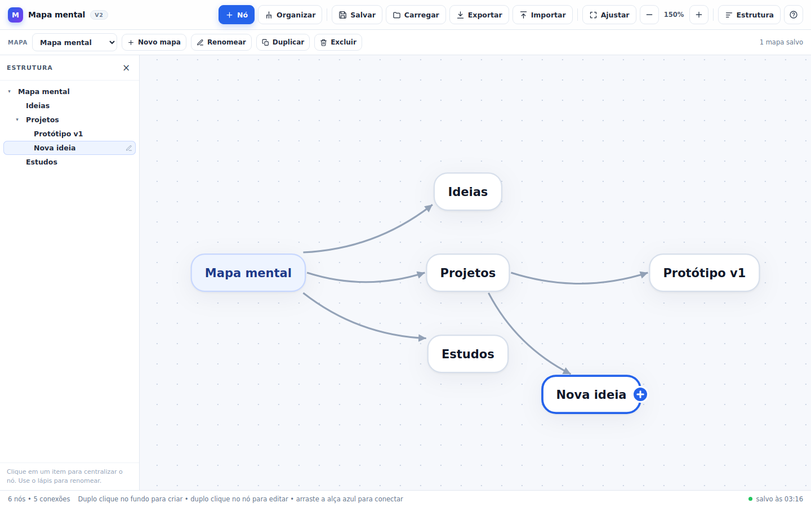
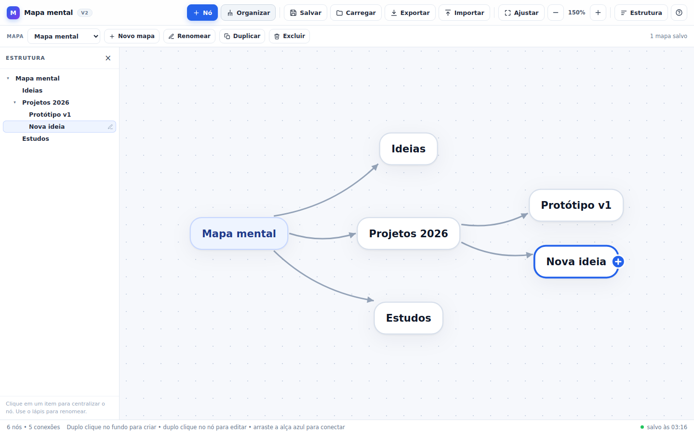
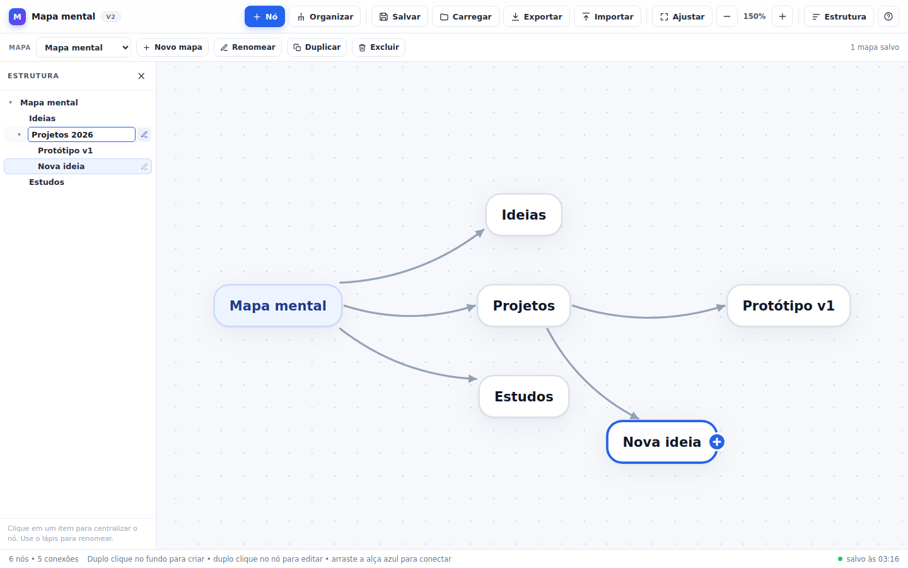
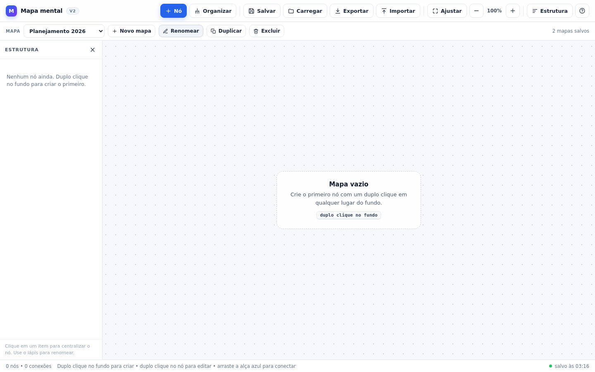
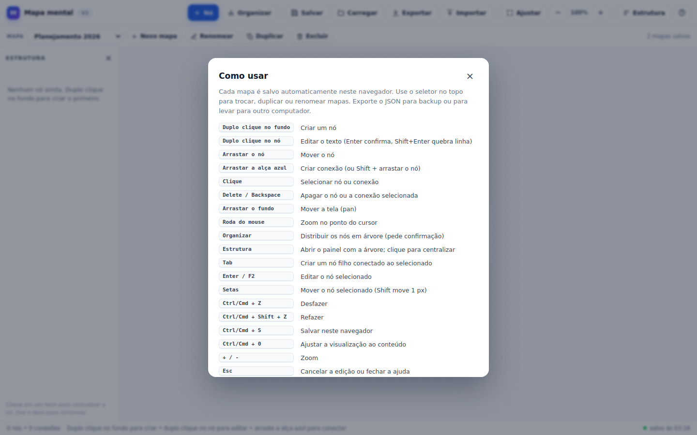
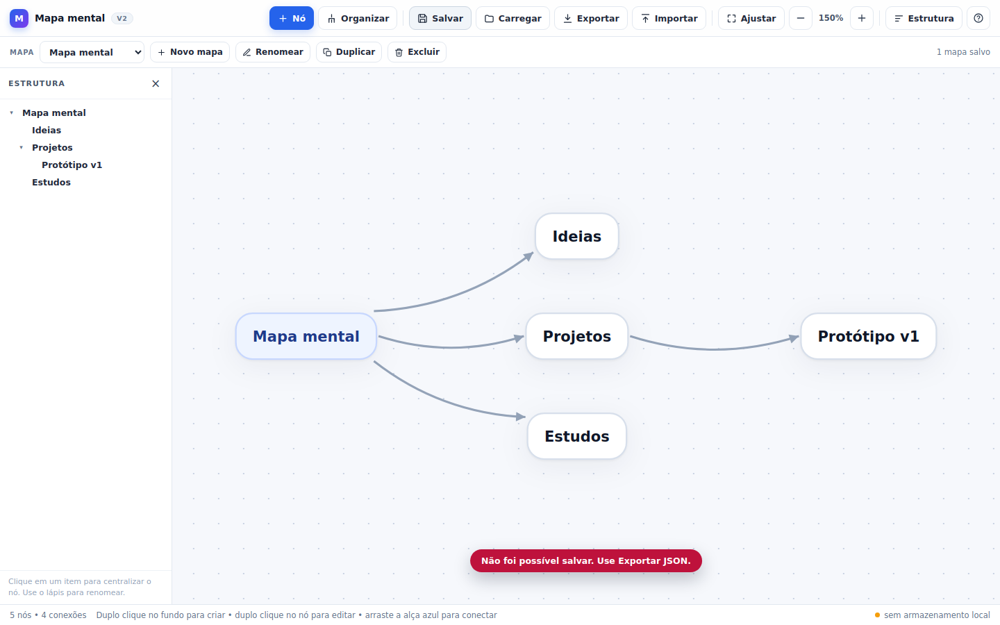

# Tutorial do editor de mapas mentais (v2)

Este tutorial vai do zero ao primeiro mapa salvo. O editor é um arquivo único
(`index.html`), sem instalação, servidor, conta ou conexão com a internet.



## 1. Abrir o editor

1. Baixe ou clone o repositório.
2. Dê um duplo clique em `index.html` (ou arraste o arquivo para uma aba do
   navegador).
3. Na primeira abertura aparece um mapa de exemplo. Use **Novo mapa** para
   começar do zero.

Funciona em versões recentes de Chrome, Edge, Firefox e Safari. O editor abre
direto de `file://` porque não usa módulos ES, `fetch`, CDN, npm nem build.

## 2. Conhecer a tela

- **Barra principal:** criar nó, **Organizar**, salvar, carregar, exportar,
  importar, ajustar a visualização, zoom, painel **Estrutura** e ajuda.
- **Barra de mapas:** seletor de mapas e ações **Novo mapa**, **Renomear**,
  **Duplicar** e **Excluir**.
- **Painel Estrutura:** árvore dos nós. Clique em um item para centralizar o nó;
  use o lápis para renomear; use a seta para recolher ou expandir um ramo.
- **Barra de status:** quantidade de nós e conexões, dica de uso e estado do
  salvamento (por exemplo, “salvo às 14:32” ou “sem armazenamento local”).

## 3. Criar o primeiro nó

Em um mapa vazio, dê um **duplo clique no fundo** na posição desejada. O nó é
criado já em modo de edição, com o texto selecionado para você digitar.

Também é possível usar o botão **Nó**:

- sem seleção, ele cria um nó no centro da área visível;
- com um nó selecionado, ele cria um **filho** já conectado ao nó selecionado
  (o mesmo que a tecla `Tab`).

## 4. Editar o texto

Dê um **duplo clique no nó** (ou selecione e pressione `Enter`/`F2`). Digite o
texto e confirme:

- `Enter` confirma;
- `Shift + Enter` quebra a linha;
- `Esc` cancela a edição e mantém o texto anterior.



Textos longos são quebrados em até oito linhas; o nó cresce para caber no
conteúdo.

## 5. Conectar nós

Há dois jeitos de criar uma conexão:

1. Selecione o nó de origem. Arraste a **alça azul com “+”** que aparece à
   direita do nó até o nó de destino.
2. Segure `Shift` e arraste o nó de origem até o nó de destino.

A conexão é **direcionada**: a seta aponta da origem para o destino. Isso
importa para o autolayout, que usa as conexões para montar a árvore.



Para apagar uma conexão, clique nela e pressione `Delete` (ou `Backspace`).

## 6. Mover, selecionar, apagar, navegar

- **Mover nó:** arraste o nó. As setas do teclado também movem o nó selecionado
  (8 px; com `Shift`, 1 px).
- **Selecionar:** clique no nó ou na conexão.
- **Apagar:** `Delete` ou `Backspace`. Apagar um nó remove as conexões ligadas a
  ele.
- **Pan:** arraste o fundo do mapa.
- **Zoom:** use a roda do mouse (o zoom acontece no ponto do cursor), os botões
  `−`/`+` ou as teclas `+`/`−`. **Ajustar** (`Ctrl/Cmd + 0`) enquadra todo o
  conteúdo.

## 7. Organizar o mapa em árvore

O botão **Organizar** distribui os nós por nível, usando as conexões como
hierarquia. Ele evita sobreposição, mantém os títulos legíveis e tenta preservar
a ordem vertical em que os nós já estavam.



Como o autolayout substitui as posições atuais, o editor **pede confirmação**
antes de reorganizar. Se mudar de ideia depois, use `Ctrl/Cmd + Z`: o desfazer
restaura as posições anteriores.

Observações:

- nós sem conexão de entrada viram raízes; componentes separados são
  empilhados;
- conexões que formam ciclos continuam visíveis, mas não entram no cálculo da
  árvore;
- se você mover um nó manualmente, a posição só muda de novo quando **Organizar**
  for confirmado.

## 8. Usar o painel de estrutura

O painel **Estrutura** mostra a árvore dos nós e ajuda a navegar em mapas
grandes.

- **Clique** no nome de um nó para centralizá-lo na tela e selecioná-lo.
- **Lápis**: renomeia o nó direto no painel. `Enter` confirma, `Esc` cancela.
  O painel edita uma linha por vez; para várias linhas, use o editor do nó.
- **Seta**: recolhe ou expande os filhos daquele ramo.
- O botão **Estrutura** na barra principal mostra ou oculta o painel. Em telas
  estreitas ele vira uma gaveta sobre o mapa e fecha ao escolher um nó.



## 9. Vários mapas nomeados

Todos os mapas ficam no mesmo navegador, em `localStorage`. O seletor no topo
mostra o mapa ativo e permite trocar entre eles.

- **Novo mapa:** cria um mapa vazio com nome automático (“Mapa 1”, “Mapa 2”…).
  O mapa atual continua salvo.
- **Renomear:** abre uma caixa de texto com o nome atual. Nomes repetidos são
  recusados.
- **Duplicar:** cria uma cópia do mapa ativo, com novos identificadores e o nome
  “(cópia)”. O original não é alterado.
- **Excluir:** remove o mapa ativo após confirmação. Se for o último mapa, o
  editor cria um mapa vazio para continuar funcionando.



A troca de mapa salva a posição da câmera de cada um. O desfazer é independente
por mapa e fica apenas na memória da aba: ao recarregar a página, o histórico de
desfazer começa de novo, mas o conteúdo salvo permanece.

## 10. Salvar e carregar

O editor salva sozinho no `localStorage` **500 ms depois** da última alteração de
conteúdo ou de câmera. Isso evita gravar a cada `pointermove` durante um arraste.
O estado aparece na barra de status:

- “salvo às HH:MM” — gravou com sucesso;
- “carregado do navegador” — acabou de abrir dados existentes;
- “sem armazenamento local” — o navegador bloqueou o `localStorage` (veja a
  seção 13).

**Salvar** (`Ctrl/Cmd + S`) força a gravação imediata. Se nada mudou desde a
última gravação, o editor avisa que já está tudo salvo, em vez de reescrever o
mesmo conteúdo. **Carregar** relê o que está no navegador e pede confirmação,
pois descarta alterações ainda não gravadas.

Ao fechar ou recarregar a aba, o editor tenta gravar o estado pendente.

## 11. Exportar e importar JSON

- **Exportar** baixa um arquivo JSON com o mapa ativo, incluindo nome, câmera,
  nós e conexões. O nome do arquivo vem do nome do mapa (por exemplo,
  `planejamento-2026.json`).
- **Importar** abre um arquivo exportado antes. A importação **substitui o
  conteúdo do mapa ativo** (o editor pede confirmação se o mapa não estiver
  vazio). As posições e a câmera do arquivo são respeitadas quando ele tem
  `viewport`; se não tiver, o mapa é enquadrado na tela automaticamente.
- Se o JSON for inválido, o editor mostra uma mensagem e mantém o mapa atual.

O formato é versionado e legível:

```json
{
  "formatVersion": 1,
  "app": "editor-de-mapas-mentais",
  "name": "Planejamento 2026",
  "updatedAt": "2026-11-04T03:16:00.000Z",
  "viewport": { "x": 720, "y": 450, "scale": 1 },
  "nodes": [
    { "id": "n-raiz", "text": "Mapa mental", "x": 0, "y": 0 }
  ],
  "edges": [
    { "id": "e-1", "from": "n-raiz", "to": "n-ideias" }
  ]
}
```

`formatVersion` 1 é o formato de um mapa individual. O conjunto de mapas é
gravado internamente em outra chave, com `formatVersion` 2; a exportação continua
sendo de um mapa por arquivo. A v1 é migrada automaticamente na primeira
abertura da v2, e a chave antiga é mantida como cópia de segurança.

## 12. Atalhos

| Atalho | Ação |
| --- | --- |
| `Tab` | Cria um nó filho conectado ao nó selecionado |
| `Enter` ou `F2` | Edita o nó selecionado |
| Setas | Move o nó selecionado 8 px (`Shift` move 1 px) |
| `Delete` / `Backspace` | Apaga o nó ou a conexão selecionada |
| `Ctrl/Cmd + Z` | Desfaz (até 50 passos) |
| `Ctrl/Cmd + Shift + Z` ou `Ctrl/Cmd + Y` | Refaz |
| `Ctrl/Cmd + S` | Salva neste navegador imediatamente |
| `Ctrl/Cmd + 0` | Ajusta a visualização ao conteúdo |
| `+` / `−` | Zoom |
| `0` | Volta ao zoom de 100% |
| `Esc` | Cancela a edição, limpa a seleção ou fecha a ajuda |



## 13. Quando o `localStorage` está bloqueado

Alguns navegadores bloqueiam `localStorage` em `file://`, em janelas privadas ou
por configuração de privacidade. O editor continua funcionando em memória e
avisa no canto inferior direito. Ao tentar salvar, aparece:

> Não foi possível salvar. Use Exportar JSON.



Nesse caso:

1. use **Exportar** para baixar o JSON e guardar o arquivo;
2. para continuar depois, abra o editor e use **Importar**;
3. se quiser tentar liberar o salvamento automático, abra o `index.html` por
   `http://` em um servidor local ou ajuste as permissões de armazenamento do
   navegador.

Exportar e importar também são a forma recomendada de backup e de levar o mapa
para outro computador, já que cada navegador tem o seu próprio `localStorage`.

## 14. Dicas e limitações

- O mapa é um grafo direcionado; o autolayout usa uma árvore derivada das
  conexões. Conexões extras e ciclos continuam sendo exibidos, mas não alteram o
  posicionamento.
- O painel de estrutura renomeia uma linha por vez. Para textos com várias
  linhas, edite o nó no mapa.
- O editor foi pensado para mapas pequenos e médios (algumas centenas de nós).
  Mapas muito grandes podem ficar menos fluidos, dependendo do navegador.
- Não há colaboração em tempo real, imagens/embeds nem gesto de pinça; o foco da
  v2 foi desempenho, organização e documentação.
- Para entender o código e saber onde adicionar um recurso, veja
  [arquitetura.md](arquitetura.md).
